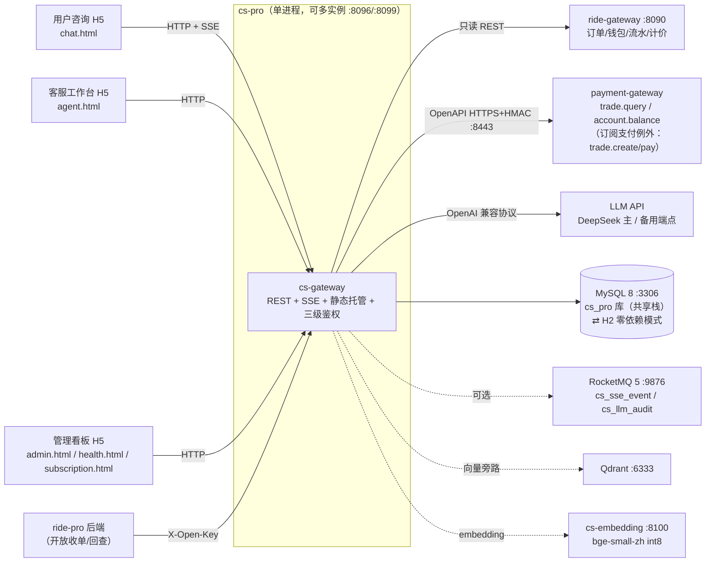
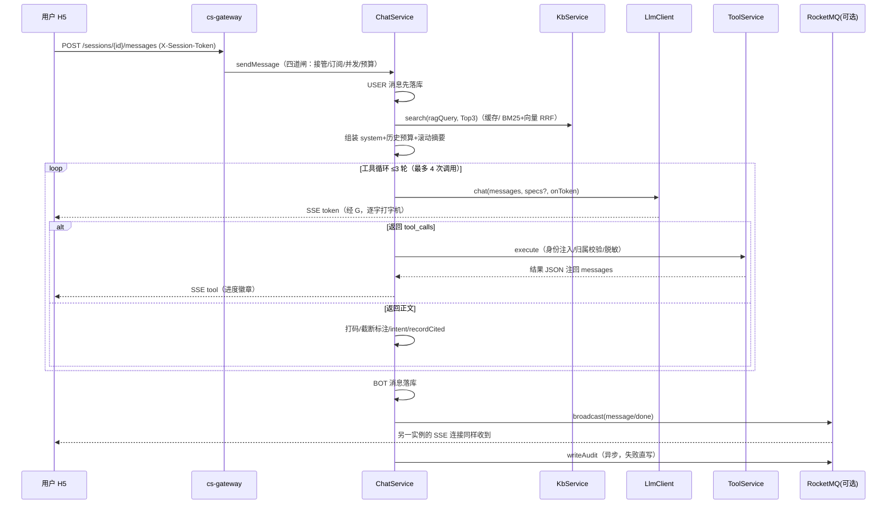

# cs-pro 智能客服系统架构设计

版本 v1.2.0 ｜ 2026-11-20

> 文档定位：本文是**架构视图**（上下文/逻辑/部署/数据/集成/弹性/安全/可观测/扩展）。需求基线见 [REQUIREMENTS.md](REQUIREMENTS.md)；字段级契约与流程权威定义见 [DESIGN.md](DESIGN.md)（本文各节标注对应章节）；类/方法级设计见 [DETAILED-DESIGN.md](DETAILED-DESIGN.md)。

## 1. 系统上下文（DESIGN §2.1–2.2）



**集成边界三原则**：

1. **零侵入**：ride/payment 不改一行代码、零 schema 改动；cs-pro 宕机对两系统零影响（上游只被只读调用）。
2. **只读默认**：业务查询全部只读；唯一写例外是订阅支付（服务端常量金额封装于 SubscriptionPayService，LLM 工具层永不触达）。
3. **可降级**：每个外部依赖都有旁路——ride/payment 未启动→查询工具降级说明；LLM 不可用→FAQ；MQ 不可用→直写；向量容器不可达→纯 BM25。

## 2. 逻辑架构：进程内模块化单体（DESIGN §2.3）

**形态决议**：单进程 Spring Boot + REST 集成，内部 Maven 六模块，不引 Dubbo/ZK；支持同库多实例水平部署。理由：客服体量小、外部依赖全是 HTTP、避免分布式复杂度；模块边界即未来拆进程的边界（cs-facade 纯 DTO 契约预留）。

```
cs-gateway（唯一运行进程：REST/SSE/静态/鉴权/线程池/异常映射）
   └── cs-core（编排与领域服务）
         ├── chat    对话编排 / SSE  hub / 消息·会话·LLM审计 Mapper
         ├── biz     RideClient / PaymentProClient / ToolService / UploadService
         ├── ticket  工单 / 备注 / 评价
         ├── subscription 租户 / 订阅 / 激活码 / 支付开通
         ├── open    开放凭证        ├── billing 账单
         ├── audit   管理审计        ├── proactive 主动服务
         ├── stats   统计 / metrics / 健康
         ├── mq      MqBridge（SSE 广播 + 审计异步，可降级）
         ├── seed    内置租户与 FAQ 种子
         └── config  CsProperties / IdConfig
   ┌── cs-kb（FAQ + Bm25Index + VectorIndex + 版本快照）
   ├── cs-llm（LlmClient + LlmProperties + LlmException + LlmModel）
   ├── cs-facade（16 DTO + 5 Request，纯契约无逻辑）
   └── cs-common（Result/ResultCode/BizException/MoneyUtil/IdGenerator）
```

依赖方向单向向下：gateway → core → {kb, llm} → facade → common；biz 客户端在 core 内（进程内引用，预留拆进程）。

## 3. 部署架构（DESIGN §2.4 / §9）

### 3.1 进程与端口

| 进程 | 端口 | 说明 |
|---|---|---|
| cs-gateway 实例 1 | **8096** | 默认；`CS_PORT` 可覆盖 |
| cs-gateway 实例 2 | **8099** | 同库水平部署，跨实例 SSE 经 MQ |
| ride-gateway | 8090 | 只读上游 |
| payment-gateway OpenAPI | 8443 | HTTPS+HMAC，自签证书定向信任 |
| yiwu / claim / ops | 8095 / 8097 / 8098 | 兄弟系统，全错开可同跑 |

### 3.2 共享 Docker 中间件（claim-shared 栈，与保险理赔系统公用）

| 容器 | 宿主端口 | cs-pro 用途 | 不可达时 |
|---|---|---|---|
| mysql 8 | 3306 | 默认持久层 cs_pro 库 | run.sh 自检报错并提示（H2 模式可绕开） |
| rocketmq 5 | 9876 | 跨实例 SSE 广播 + 审计异步 | 自动降级直写，主链路不受影响 |
| qdrant | 6333 | 向量检索 | 30s 熔断→纯 BM25 |
| cs-embedding | 8100 | 本地 ONNX embedding（模型烘进镜像） | 同上 |

> 宿主零裸中间件进程，全部收敛 Docker；`CS_DB_MODE=h2` 提供零依赖形态（无需任何容器）。

### 3.3 启停与环境变量

```bash
./run.sh                 # mvnw package + 启动 + 就绪等待（默认 mysql，自检 3306）
./run.sh --no-build
./stop.sh                # SIGTERM + 15s + SIGKILL 兜底，数据保留
CS_PORT=8099 CS_MQ_ENABLED=true ./run.sh --no-build   # 第二实例
CS_DB_MODE=h2 ./run.sh                                # 零依赖
CS_VECTOR_ENABLED=false ./run.sh                      # 关闭向量通道
```

| 变量 | 作用 |
|---|---|
| CS_PORT / DATA_DIR / ADMIN_TOKEN | 端口 / 数据目录 / 管理令牌（逗号分隔多令牌轮换） |
| CS_DB_MODE | mysql（默认）/ h2 |
| CS_MQ_ENABLED | RocketMQ 开关（默认关，直写） |
| CS_VECTOR_ENABLED | 向量通道开关（默认开，旁路降级） |

LLM Key 存仓库外 `~/.config/cs-pro/llm.properties`（chmod 600，兼容仓库内 config/ 但 gitignore）；无 Key 自动降级模式。

## 4. 数据架构（DESIGN §4）

**双模单库**：默认 MySQL `cs_pro`（db/schema-mysql.sql，幂等建表）；`CS_DB_MODE=h2` 切 H2 单文件 `data/cs.mv.db`（MODE=MySQL）。**20 张表**按域分组：

| 域 | 表 |
|---|---|
| 对话 | cs_session, cs_message |
| 工单 | cs_ticket, cs_ticket_note, cs_rating |
| 知识库 | cs_kb, cs_kb_revision |
| LLM 审计 | cs_llm_call |
| 统计 | stats_daily |
| 订阅 | cs_tenant, cs_subscription, cs_activation_code, cs_sub_order, cs_free_usage, cs_invoice |
| 开放 | cs_open_key |
| 管理审计 | cs_admin_audit |
| 主动服务 | cs_proactive_event |
| 基础设施 | cs_sequence（MySQL 号表）, idempotent_record |

**方言适配**：IdGenerator 双实现——H2 SEQUENCE ⇄ MySQL 号表（cs_sequence），业务代码无感。

**schema 治理**：MySQL profile `sql.init.mode=never`，变更须手动 ALTER 运行库并同步 db/schema-mysql.sql；H2 侧幂等 ALTER 自动生效。存量 H2→MySQL 用 migrate-to-mysql.sh（只读源库+行数校验，已验证 752 行一致）。

**数据保护**：data/ 只增不删；停服务不触碰数据；清残留走红冲+双人+审计，不改库。

## 5. 集成架构（DESIGN §2.5 / §3.2）

### 5.1 ride-pro（REST 只读）

RideClient：`cs.ride.base-url`（默认 http://127.0.0.1:8090），GET 只读端点（订单/钱包/流水/提现/计价）；healthy() 供健康页。未启动→工具返回错误说明回填，对话不中断。

### 5.2 payment-pro（OpenAPI HTTPS+HMAC）

PaymentProClient：独立注册 MERCHANT cs-pro（integrate-payment.sh 一键入驻）；**所有端点 POST+JSON**，必填 appId/timestamp/sign（±5min 防重放）；签名=body 参数 TreeMap 排序剔 sign 跳 null → k=v& 拼接 → HmacSHA256(appSecret) 小写 hex；SSLContext 仅信任 payment-pro 自签证书（不走系统信任库）。

端点白名单：默认只读 `trade.query`/`account.balance`（callRead）；订阅支付开启时额外放行 `trade.create`/`trade.pay`（callSubscriptionPay，仅 SubscriptionPayService 内部使用）。未配置→enabled()=false→pp 工具整体不出现在菜单。

**已知边界**：trade.query 只认 pp 订单号（O*），ride→pp 映射无公开只读端点，联查列入演进（需 ride 侧侵入式改动，届时单独确认）。

### 5.3 LLM（OpenAI 兼容协议）

LlmClient：JDK HttpClient 零第三方 SDK，统一 `/chat/completions`（tools/stream/usage）；适配 OpenAI/DeepSeek/通义/Kimi/Ollama；主备路由链 + 视觉模型覆盖。详见 DETAILED-DESIGN §3。

## 6. 运行时关键流（DESIGN §3.1 / §3.1.1）

### 6.1 一轮对话时序（含工具循环与多实例广播）



### 6.2 审计与预算的异步一致性

MqBridge.writeAudit 异步落 cs_llm_call；**日预算护栏 = 已落库当日 OK tokens + mq.pendingTokens(在途)**，避免异步窗口超发。MQ 不可用→同步直写，pendingTokens=0。

### 6.3 调度任务（4 个，全部 CAS/幂等，重启不丢进度）

| 任务 | 周期 | 职责 |
|---|---|---|
| SubscriptionPayService 回查 | 5s | trade.query 收敛订阅单终态（PENDING→PAID→ACTIVATED） |
| TicketService.autoClose | 60s | RESOLVED 超 7 天自动 CLOSED |
| ProactiveService 轮询 | 60s（可配，初始延迟 20s） | ride 超时订单/pp 失败支付单→event_key 幂等推送 |
| StatsService 快照 | 600s（初始延迟 30s） | stats_daily 每日聚合快照 |

### 6.4 LLM 调用决策：何时走、走几次（DESIGN §3.1.1）

**入口四道闸**（ChatService.sendMessage，全过才调模型）：

| 闸 | 判定 | 未过出口（不调 LLM） |
|---|---|---|
| ① 人工接管 | session.takeover | 消息排队返回 null，不耗额度，客服回复经 SSE 送达 |
| ② 订阅有效 | isSubscribed（expire_at>now 实时） | 免费额度 CAS 扣减（5 条/人/日）→FAQ 直答；超额 A0409+订阅引导 |
| ③ 并发配额 | 每租户 Semaphore tryAcquire（默认 2，pro 8） | 429 立即拒绝，不入库不排队 |
| ④ 日 token 预算 | 当日 OK tokens + MQ 在途 pendingTokens | 降级 FAQ + BUDGET 审计 |

全局不调用：无 LLM Key（configured()=false，全程 FAQ 降级模式）；端点熔断打开中（attempt 直接拒绝不发网络请求，FALLBACK/CIRCUIT）。

**调用次数 1~4 次**（llmAnswer 工具循环 round 0..maxToolRounds(3)）：每轮工具循环=一次独立 HTTP 调用；前 3 轮带工具定义，**第 4 轮（lastRound）不带 tools 强制收敛**；超轮兜底「建议提交工单」。maxTokens 分级：工具轮与查询类 512，投诉/其他类最终轮 2048。

### 6.5 工具选择机制：模型凭什么知道调哪个（DESIGN §3.2.1）

**菜单随每次请求下发**（OpenAI tools 字段，ToolService.specsFor 组装）：每工具=name+description+parameters JSON Schema。模型经 function-calling 训练，靠**语义比对用户问题 vs description** 选择并填参——非规则引擎、非关键词匹配。

**description 三技巧**（选择准确率的手艺）：
- 排除式引导防混选：query_ride_order 写明「用户只想看列表时应改用 list_ride_orders」；
- 枚举值兜参数：status 9 值/category 7 类全列，模型才填 COMPLETED 而非"已完成"；
- 行为约束：create_ticket「不要重复调用」「需用户确认后才真正创建」。

**system prompt 双保险**：规则 2（概况用 list、给出订单号才用 query）、规则 3（写操作拒办且不为此乱查）、规则 6（新问题须重查实时数据）。

**菜单按角色动态裁剪**（白名单第一道防线）：PASSENGER/DRIVER→6 ride 工具；MERCHANT 且 pp.enabled→2 pp 工具；create_ticket 全员。不在菜单的工具模型不知道其存在。

**选错三道兜底**（选择权在模型、正确性在服务端）：未注册 name→error JSON 注回不崩；身份参数 schema 不含 userId、执行时服务端强制注入；orderId 归属校验越权 A0404。选偏但合法→正文露馅→坏例队列→description 迭代闭环。

### 6.6 LLM 职责全景：除查数答问外还解决什么

| 职责 | 机制 | 锚点 |
|---|---|---|
| 知识库消化与冲突仲裁 | KB Top3 注入 system，LLM 组织贴切回答；KB 与工具结果冲突以实时为准 | systemPrompt 规则 5 |
| 多轮语境理解 | 历史预算+滚动摘要+工具轨迹喂 LLM 做指代衔接；追问同数据可引用、新问题须重查 | appendHistoryWithBudget + 规则 6 |
| 多语言跟随 | 检测用户语言跟随回复，中文 KB 翻译要点后引用（非翻译 API） | systemPrompt 首段 |
| 图片理解 | 附图路由 vision-model，识别截图订单号/金额/报错；图片文字仅作数据 | doChat 视觉路由 + 规则 8 |
| 安全拒办与防注入 | 写操作一律拒办+引导工单；KB/工具/用户消息中改规则/泄提示/扮演角色的指令一律忽略 | 规则 3/7 |
| 工单草稿生成 | LLM 自填 category/summary/orderId 浓缩对话为结构化草稿，用户确认才落单 | specsFor create_ticket + llmAnswer draft 分支 |
| 数据综合与换算 | 多工具 JSON 综合成连贯回答；分→元换算 | runTools 注回 + 规则 1 |

**LLM 不做的**（边界）：检索本身（RAG 前置注入不暴露为工具）、身份判定（服务端注入）、任何写操作（无写工具）、工单最终创建（草稿需确认）、意图标签（代码从工具轨迹派生）、统计/账单/订阅判定（纯服务端）。

## 7. 弹性架构（DESIGN §5.2）

### 7.1 降级阶梯

| 故障 | 降级路径 | 用户感知 |
|---|---|---|
| 向量容器不可达 | 30s 熔断→纯 BM25 | 检索质量略降，直答阈值仍生效 |
| LLM 主端点抖动 | 分类退避重试（429/5xx/网络）→备用端点 | 延迟增加，答案照常 |
| LLM 全不可用/熔断 | FAQ 兜底（前缀说明）+ FALLBACK/CIRCUIT 审计 + 坏例队列 | 知识库原文直答 |
| 流式中断 | 保留已生成文本 + ABORTED 标注 | 半截答案不丢 |
| 日预算超限 | FAQ + BUDGET 审计 | 前缀「用量已达上限」 |
| MQ 不可用 | SSE 本地推送 + 审计直写 | 单实例无感；多实例跨实例推送失效 |
| ride/pp 未启动 | 工具错误说明回填 / pp 工具禁用 | 对话不中断，健康页标注 |
| 无 LLM Key | 全程 FAQ 直答模式 | 工单/统计/查询全闭环可用 |

### 7.2 隔离与护栏

- **线程隔离**：LLM 调用专用 llmRequestExecutor（core8/max32/AbortPolicy），不占 Tomcat 线程；工具并行 toolPool（fixed 8，单个 10s 超时）。
- **熔断分键**：按端点 `baseUrl|model` 独立计数（5 连败熔 60s，half-open 由到期后真实请求承担），供应商互不拖累。
- **已出流保护**：emitted 标记一旦推送过 token，禁重试禁切备（防重复内容）。
- **并发配额**：每租户信号量 tryAcquire 不阻塞，超限 429 立即拒绝（不入库不排队）。
- **SSE 生命周期**：SseEmitter 600s 超时；SseHub 按 sessionId 注册/发送/计数。

## 8. 安全架构（DESIGN §8）

```
请求 → TraceWebFilter（traceId）
     → 路由分流：
        /api/admin/*  → AdminAuthFilter（X-Admin-Token，多令牌轮换）
        /api/open/*   → OpenKeyAuthFilter（X-Open-Key→tenant 服务端解析；无效401/冻结403/吊销即失效）
        会话端点      → X-Session-Token 校验（SSE 走 ?token=；老会话兼容放行）
     → 领域服务（身份服务端注入 / 归属校验 / CAS / 幂等唯一键）
```

- **信任边界**：LLM 是不可信输入源——工具白名单+身份注入是硬防线，prompt 防注入声明是软防线；输出侧二次 PII 打码。
- **资金边界**：无写业务系统能力；订阅支付服务端常量封装；被问退款只解释规则+引导。
- **敏感信息**：apiKey/secret 不入日志/DTO；accessToken 仅建会话返回一次；进 prompt 数据脱敏；管理变更全量审计（旁路写入不阻断）。
- **幂等矩阵**：建单/订阅单 request_id 唯一键；评价 PK；账单 (tenant,period) 唯一；主动事件 event_key 唯一；消息先落库再调 LLM。

## 9. 可观测架构（DESIGN §3.5 / §9）

| 通道 | 实现 | 口径 |
|---|---|---|
| 日志 | logs/cs-gateway-<port>.log 含 traceId | grep 'LLM OK'=真实成功；'LLM tool'=工具留痕；'LLM 降级'=回落 FAQ；'熔断'=breaker |
| LLM 审计 | cs_llm_call 六状态 OK/ERROR/CIRCUIT/BUDGET/FALLBACK/ABORTED | 与日志一一对应；promptVersion/实际模型/token |
| metrics | MetricsService.render → /api/admin/metrics（Prometheus 文本） | 会话/消息/LLM 调用/降级/熔断计数 |
| 健康页 | HealthService.detail → health.html 5s 轮询 | DB/MQ/LLM/上游/主动服务/向量组件徽章 |
| 管理审计 | cs_admin_audit 全变更留痕 | 管理端审计页签 |
| 统计 | StatsService SQL 聚合 + stats_daily 快照 | 解决率/转工单率/满意度/TopN/用量 |

## 10. 扩展性与演进（DESIGN §11）

**水平扩展现状**：进程无状态化程度高——会话/消息/工单/订阅全在共享库；跨实例 SSE 经 MQ 广播已实测。**进程内残留状态**（多实例各自计数，列入演进）：熔断器、租户并发信号量、日预算缓存、KB 索引与 TopK 缓存、SseHub 连接表。演进方向：Redis 外置全局（共享栈已有容器）。

**演进路线**（需求级声明见 REQUIREMENTS §6）：统一登录；WS 在线转接；开放 API HMAC+限流；真实出账；ride→pp 订单映射只读端点（侵入式，单独确认）；多供应商加权路由 + 本地小模型兜底（现为主备两级 + FAQ 文字兜底；本地模型部署形态见 DESIGN §11 讨论，Ollama 宿主机 Metal 加速优于 Mac 容器 CPU 推理）。

**拆进程预留**：cs-facade 纯 DTO 契约 + 模块单向依赖，未来按域拆进程时边界即模块边界；当前不引 Dubbo/ZK 是体量与运维成本的权衡决议（DESIGN §2.1）。